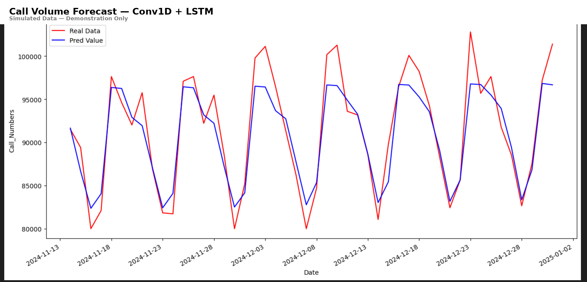

# Conv1D + LSTM Call Volume Forecasting

> 📌 This project was developed end-to-end by **Xichun Han** as a demonstration of time series forecasting with hybrid deep learning.  
> It is shared under the MIT License for educational purposes. If reused, **proper attribution is expected**.

---

## Overview

This project builds a deep learning pipeline to forecast daily inbound call volumes using a hybrid Conv1D + LSTM architecture. The code is structured for reproducibility using fully simulated data and mimics real-world capacity trends, holiday effects, and seasonal fluctuations.

Originally built to support staffing optimization at luxury travel company, this forecasting system reduced error by ~30% compared to Excel-based manual trendlines.

---

## Highlights

- **Problem framing**: *disaggregation* — given an externally-forecast monthly total, learn the daily distribution within it (see "Design Notes" below)
- **Model**: Conv1D layers for pattern extraction + LSTM layers for sequential memory
- **Features**: Simulated business metrics (`RollCap`, `monthly_sum`), U.S. holidays, and calendar signals
- **Optimization**: Hyperparameter tuning with `GridSearchCV` + `TimeSeriesSplit` (no shuffling on time-ordered data)
- **Reproducibility**: all RNGs seeded (`tf.keras.utils.set_random_seed`, NumPy, simulator)
- **Stack**: TensorFlow/Keras, scikit-learn, pandas, holidays

---

## Repository Structure

```
├── _sim_config.py                  # shared constants + helpers for the 3 generators
├── generate_dummy_data.py          # historical daily data
├── generate_monthly_sum_data.py    # future monthly totals (simulated external forecast)
├── generate_rollcap_dummy_data.py  # future RollCap exogenous series
├── LSTM_CONV1D_Model.py            # training + forecasting entry point
├── LSTM_CONV1D_Forecast.ipynb      # exploratory twin; the .py is authoritative
├── requirements.txt
└── README.md
```

---

## Features

| Feature        | Description                                              |
|----------------|----------------------------------------------------------|
| `Total_Presented` | Target variable – daily inbound calls                 |
| `RollCap`      | 30-day rolling sum of projected capacity                 |
| `monthly_sum`  | Externally-forecast monthly total (noisy at inference)   |
| `Holiday_A`    | Full-company closure (e.g., Christmas)                   |
| `Holiday_B`    | Reduced operation holidays (e.g., Labor Day)             |
| `weekday`, `week_number`, `month` | Calendar-based seasonality             |

---

## Model Architecture

- **Input**: `(7, 8)` sliding window of features
- **Conv1D Layers**: 64 & 32 filters (kernels 5 & 3), ReLU
- **LSTM Layers**: 3 stacked LSTMs with dropout & L2 regularization
- **Dense Layers**: 32-unit hidden layer + 1-unit output
- **Optimization**: Adam / Nadam, learning rate grid, batch size grid
- **Loss Function**: Mean Squared Error (MSE)
- **EarlyStopping**: Stops when training loss stagnates

---

## How to Run

```bash
# Step 1: Generate synthetic training + future data
python generate_dummy_data.py
python generate_monthly_sum_data.py
python generate_rollcap_dummy_data.py

# Step 2: Train and forecast
python LSTM_CONV1D_Model.py
```

Model outputs:
- Scaled and original-scale MAE/MSE
- Forecast plot vs historical
- Future prediction CSV (optional)

---

## Design Notes

**Why `monthly_sum` is a feature, not a leak.** In the original business
context this model solved, the month-level total is supplied externally by
the finance/planning team, and the NN's job is to distribute it across the
days of the month using learned weekday / holiday / trend patterns. That
makes it a *disaggregation* (or top-down reconciliation) problem — the
monthly aggregate is an input at inference, not a forbidden aggregate of the
target.

**Noise injection on `monthly_sum` (training-time).** On historical data,
`monthly_sum` is the *exact* sum of the target that month — noise-free. A
model trained on that signal over-relies on it and breaks when deployed
against real external monthly forecasts (which typically drift 5–10%). To
close the train/inference distribution gap,
[`inject_monthly_sum_noise`](LSTM_CONV1D_Model.py) multiplies each month's
value by a per-month jitter factor ~ N(1, 0.05) (one factor per month,
shared across all days in that month, seed-locked for reproducibility).
At inference, `future_Month_Sum.csv` is itself the "noisy external
forecast" role, so no extra perturbation is applied.

---

## Results

*Reported numbers are from `pipeline_output_new.log` after the refactor.
Noise injection intentionally raises MAE vs. the pre-refactor 0.0485 — the
new number honestly reflects the disaggregation task under realistic
monthly-forecast drift.*

| Metric                        | Value    | Note                                      |
|-------------------------------|----------|-------------------------------------------|
| Scaled Test MAE (MinMax)      | 0.0856   | up from 0.0485 pre-noise (honest baseline)|
| Original-scale Test MAE       | ~2,276 / day | ≈ 2.5% relative error on ~90k/day base |
| Original-scale Test RMSE      | ~2,968 / day |                                        |

CV mean MSE (scaled, TimeSeriesSplit n_splits=3): **0.01537**.

### Caveat on hyperparameter search

This repo's CV loop is currently configured with a single combo
(`batch_size=16, epochs=30, adam, lr=0.001, l2=0.01`) because repeated
`model.fit()` calls in one Python process trigger a native-layer crash on
this Windows + TF 2.16 stack after ~2-3 fits (no Python traceback; process
exits with code 127/139). The multi-dimensional grid is kept in
`GRID_SEARCH_PARAMS` — to explore it, either expand the grid and run on a
fresh TF / Linux environment, or run the pipeline multiple times with
different hardcoded combos.

---

## Business Context

In real deployments, this architecture helped predict call demand across a 12-month horizon, accounting for cruise seasonality, promotional spikes, and U.S. holiday effects. It enabled more efficient scheduling, cost reduction, and faster decision-making in both sales and service departments.

---

## Author

**Xichun (Harrison) Han**  
[LinkedIn](https://www.linkedin.com/in/xichun-han)

---

## 📈 Forecast Visualization

Below is a sample forecast from the Conv1D + LSTM model using simulated data.



*Cover image: pre-refactor forecast (for visual demonstration).*

Current pipeline outputs:

- `cv_test_actual_vs_predicted.png` — CV test-fold predictions overlaid on actuals
- `forecast_vs_historical.png` — 12-month forward forecast joined to the last 60 days of history

---

## License

MIT License. See `LICENSE` file for details.  
Use allowed for educational purposes. **Attribution is required for reuse.**

