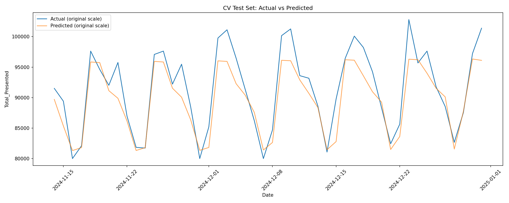
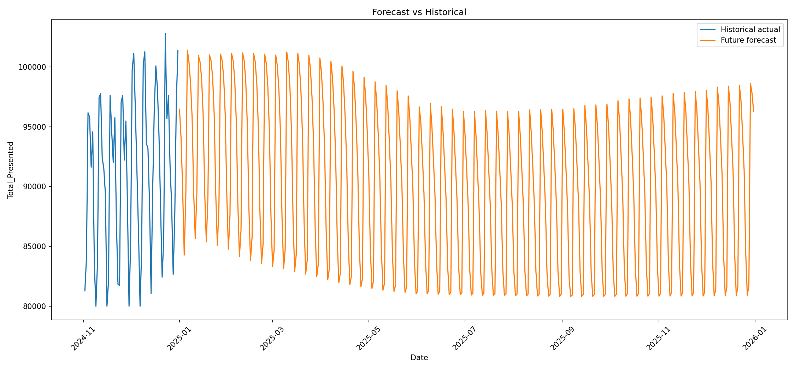

# Conv1D + LSTM Call Volume Forecasting

Daily inbound call volume for a sales center, forecast 12 months ahead with a
hybrid Conv1D + LSTM network in TensorFlow/Keras. The problem is framed as
**disaggregation**: planning supplies a monthly call total, and the model learns
how that total spreads across the days of the month from weekday, holiday,
capacity and recent-history signals. Conv1D layers pick up short local shapes
in the 7-day input window (the weekday cycle, holiday dips); the stacked LSTMs
carry the longer context the convolutions cannot. The original version ran on
real call-center data at a luxury travel company; this public version runs on
synthetic data only so the whole pipeline is reproducible from a clean checkout.

Author: **Xichun (Harrison) Han** ([LinkedIn](https://www.linkedin.com/in/xichun-han)). MIT License.

## Results

Reference numbers are from the author's run of `python LSTM_CONV1D_Model.py`
on the default synthetic data (Windows, CPU, TensorFlow 2.16.1), which produced
the plots below. The second column is an independent rerun on Linux (Python
3.12, CPU) from a clean checkout; it takes about three minutes. The target is
min-max scaled to [0, 1] for training; "original scale" is calls per day on a
base of roughly 80,000 to 100,000.

| Metric (held-out last 5% of history, 48 days)   | Reference | Linux rerun |
|--------------------------------------------------|-----------|-------------|
| Scaled test MAE                                  | 0.0856    | 0.0860      |
| Original-scale test MAE (calls/day)              | 2,276     | 2,286       |
| Original-scale test RMSE (calls/day)             | 2,968     | 2,961       |
| CV mean MSE, scaled (TimeSeriesSplit, 3 folds)   | 0.01537   | 0.01525     |

An MAE near 2,300 calls/day on a 90,000/day base is about 2.5% relative error.



*Held-out test window. The model tracks the weekly cycle and holiday dips but
under-shoots the sharpest peaks.*



*Iterative one-step-ahead forecast for 2025 appended to the last 60 days of
history. The weekly pattern and the mid-year seasonal dip are both visible.*


*Earlier version of the test-window plot, kept as the project cover image.*

## How to reproduce

Requires Python 3.12 (`.python-version`). Everything runs on CPU in a few minutes.

```bash
python -m venv .venv && source .venv/bin/activate   # Windows: .venv\Scripts\activate
pip install -r requirements.txt

# 1. Generate synthetic data (writes three CSVs into data/)
python data/generate_dummy_data.py            # 3 years of daily history
python data/generate_monthly_sum_data.py      # 12 future monthly totals
python data/generate_rollcap_dummy_data.py    # 12 months of future RollCap

# 2. Train, evaluate and forecast (writes to outputs/)
python LSTM_CONV1D_Model.py

# Quick check instead of the full 30-epoch run
python LSTM_CONV1D_Model.py --epochs 2

# Smoke test: tiny dataset, one epoch, under a minute on CPU
python -m pytest tests/
```

`python LSTM_CONV1D_Model.py --help` lists the flags (`--data-dir`,
`--output-dir`, `--epochs`). Outputs land in `outputs/`: `model_final.keras`,
`scaler_cv.pkl`, `scaler_final.pkl`, the two plots above and `forecast.csv`
with one row per forecast day.

## Project structure

```
├── LSTM_CONV1D_Model.py           # the pipeline: features -> CV -> final fit -> 12-month forecast
├── LSTM_CONV1D_Forecast.ipynb     # exploratory notebook (see note below)
├── data/
│   ├── _sim_config.py             # simulation constants shared by the three generators
│   ├── generate_dummy_data.py     # historical daily calls, capacity and RollCap
│   ├── generate_monthly_sum_data.py   # future monthly totals (stand-in for the planning forecast)
│   └── generate_rollcap_dummy_data.py # future RollCap series
├── tests/test_smoke.py            # end-to-end run on a tiny dataset
├── assets/                        # result plots embedded above
├── requirements.txt               # pinned runtime dependencies
├── requirements-notebook.txt      # extras for the notebook only
├── .python-version                # 3.12
└── LICENSE                        # MIT
```

`LSTM_CONV1D_Model.py` is the canonical pipeline. The notebook is the earlier
exploratory version and has drifted from it: it runs a 16-combination grid
search through scikeras, uses wider LSTM layers, and does not apply the
training-time noise injection described below. Read it for the exploration
(correlation heatmap, random-forest feature importances); run the script for
the results.

## Design decisions

**Features.** Eight inputs per day: the target itself, `RollCap` (30-day rolling
sum of staffed capacity), two holiday flags from the `holidays` package
(`Holiday_A` for full closures such as Christmas, `Holiday_B` for reduced-hours
holidays), weekday, ISO week number, month, and `monthly_sum`. The three
continuous columns are min-max scaled with a scaler fit on the training split
only; calendar flags are fed as integers.

**Monthly total as an input, not a leak.** `monthly_sum` is the month's call
total. In production it is supplied by planning before the month starts, so at
inference it is a legitimate input, and the model's job is the daily breakdown.

**Training-time noise on `monthly_sum`.** On historical data the monthly total
is exact, which lets the model lean on it harder than it can in production,
where the planning forecast is typically 5 to 10% off. Before training, each
month's value is multiplied by one factor drawn from N(1, 0.05), shared across
all days of that month and seeded for reproducibility. The future monthly totals
are already an external forecast, so they are not perturbed. This costs some
test accuracy on synthetic data and is kept deliberately.

**Validation.** Chronological 95/5 split, `TimeSeriesSplit` cross-validation on
the training part, early stopping on a trailing 10% validation slice for the
final fit. Nothing is shuffled. All random sources are seeded.

**Forecasting.** The 12-month horizon is produced one day at a time; each
prediction is written back into the input window for the next step, while
`RollCap`, holidays and `monthly_sum` come from the future CSVs.

## Limitations

- All data is synthetic (sinusoidal seasonality, weekday factors, Gaussian
  noise). The error figures above say the pipeline works, not how it performs
  on real traffic.
- The hyperparameter grid is reduced to one combination. Repeated `model.fit`
  calls in one process crashed on the author's Windows + TensorFlow 2.16 setup,
  so the wider search lives only in the notebook.
- There is no baseline comparison (seasonal naive, linear model) in this repo.
- The iterative forecast feeds its own predictions back in, so errors can
  compound over the 365-day horizon; this is not quantified here.
- The notebook is kept as-is with its outputs and is not maintained alongside
  the script.
